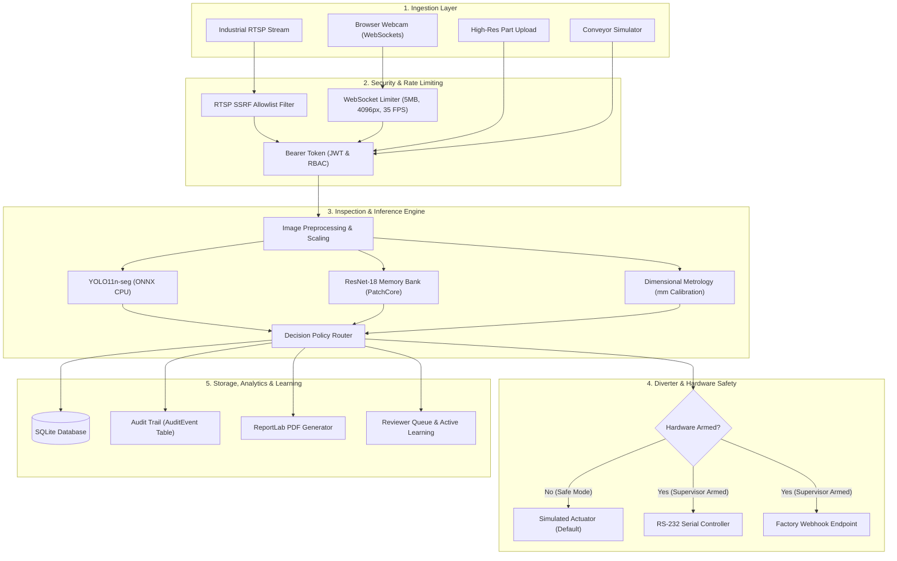

# ParakhMaan 🔬
### *See Defects Before They Become Failures.*

[](https://github.com/i-tomar/ParakhMaan-Indux5.0/tree/ParakhMaan-2.0)
[](https://www.python.org/)
[](https://fastapi.tiangolo.com/)
[](https://nextjs.org/)
[](https://react.dev/)
[](https://opencv.org/)
[](https://onnxruntime.ai/)
[](backend/tests/)
[](LICENSE)

**ParakhMaan** is an enterprise-grade, AI-powered industrial quality inspection platform engineered to detect surface anomalies, measure millimeter-accurate dimensional deviations, and automate defect classification in real time across manufacturing lines.

---

## 📌 Table of Contents

- [1. Product Overview](#1-product-overview)
- [2. Why ParakhMaan?](#2-why-parakhmaan)
- [3. Key Features](#3-key-features)
- [4. How It Works](#4-how-it-works)
- [5. System Architecture](#5-system-architecture)
- [6. Technology Stack](#6-technology-stack)
- [7. Visual Evidence & Validation](#7-visual-evidence--validation)
- [8. Hardware & Actuator Safety Controls](#8-hardware--actuator-safety-controls)
- [9. Getting Started](#9-getting-started)
- [10. API Surface](#10-api-surface)
- [11. Built for the Next Generation of Quality Inspection](#11-built-for-the-next-generation-of-quality-inspection)
- [12. Team](#12-team)

---

## 1. Product Overview

### The Industrial Reality
Modern manufacturing operates at speeds where human visual inspection cannot reliably keep pace:
- **Fatigue & Inconsistency:** Manual quality inspection results in variable defect capture rates that fluctuate across shifts and human inspectors.
- **Micro-Defects Go Unnoticed:** Hairline cracks, shallow dents, millimeter-scale dimensional deviations, and slight discoloration escape unassisted human eyes.
- **Compounding Scrap Costs:** Detecting defects at packaging or end-of-line rather than at the fabrication stage dramatically inflates manufacturing waste and recall liabilities.
- **Lack of Inspection Traceability:** Traditional visual checks leave no digital paper trail, making root-cause diagnosis across batches and machines impossible.

### The ParakhMaan Solution
**ParakhMaan** bridges high-speed optical hardware and computer vision to deliver a unified, deterministic, and auditable inspection pipeline. Operating directly on lightweight CPU-based edge nodes or centralized industrial servers, ParakhMaan:
1. **Captures & Identifies:** Ingests live video, RTSP camera streams, or uploaded part images.
2. **Localizes & Segments:** Pinpoints known defects (scratches, cracks, dents, discoloration) with pixel-level segmentation masks.
3. **Catches Novel Defects:** Applies a PatchCore memory-bank anomaly detector to identify unseen defect types without prior training.
4. **Calculates & Verifies:** Performs camera-calibrated dimensional metrology against engineering tolerances.
5. **Decides & Dispatches:** Triggers automated line policies (`ACCEPT`, `REJECT`, `MANUAL_REVIEW`) and routes pneumatic/solenoid diverters with hardware-level safety guards.

---

## 2. Why ParakhMaan?

| Capability | What ParakhMaan Delivers | Verification in Codebase |
| :--- | :--- | :--- |
| **Surface Defect Segmentation** | Pixel-level bounding polygons and segmentation masks identifying exact defect boundaries rather than coarse boxes. | `backend/app/services/inference/seg_detector.py` (YOLO11n-seg ONNX) |
| **Zero-Shot Anomaly Detection** | Detects irregular textures, foreign inclusions, and unexpected physical variations never encountered in training data. | `backend/app/services/inference/anomaly_engine.py` (PatchCore ResNet-18) |
| **Corroborated Vision** | Dual-verification pipeline where classical morphological edge detectors and golden-reference comparisons require anomaly confirmation. | `backend/app/services/defect_detection_service.py` |
| **Millimeter Metrology** | Sub-millimeter part dimension calculation using checkerboard or reference-length optical calibration. | `backend/app/services/metrology/calibration.py` |
| **Multi-Source Ingestion** | Ingestion from browser webcams, physical RTSP camera feeds, video files, or simulated conveyor triggers. | `backend/app/services/realtime/sources.py` |
| **Severity & Confidence Scoring** | Stratifies defects into `LOW`, `MEDIUM`, `HIGH`, and `CRITICAL` severity with calibrated confidence scores. | `backend/app/schemas/all_schemas.py` |
| **Enterprise Traceability** | Digital twin logging for every unit inspected, correlated with machine ID, shift, batch, timestamp, and model version. | `backend/app/models/all_models.py` |
| **Compliance & Reporting** | Instant PDF inspection certificates and batch summary audits generated automatically. | `backend/app/services/reporting_service.py` (ReportLab) |
| **Active Learning Loop** | Factory-floor reviewer feedback queue with dataset versioning, evaluation gating, and one-click model promotion/rollback. | `backend/app/services/learning/` |

---

## 3. Key Features

```
┌────────────────────────────────────────────────────────────────────────┐
│                        PARAKHMAAN PLATFORM SUITE                       │
├─────────────────────┬─────────────────────┬────────────────────────────┤
│ 🔍 Surface Analysis │ 📏 Optical Metrology│ 🛡️ Safe Line Actuation    │
│  • Pixel-level mask │  • Real mm scale    │  • Simulation by default   │
│  • Anomaly heatmaps │  • Checkerboard cal │  • Role-gated arming       │
│  • 5 defect classes │  • Tolerance checks │  • RS-232 / Webhook link   │
├─────────────────────┼─────────────────────┼────────────────────────────┤
│ 📊 Quality Analytics│ 🔄 Active Learning  │ 📑 Dual-Mode Engine        │
│  • Pareto charts    │  • Human audit loop │  • Surface defect mode     │
│  • SPC p-charts     │  • Dataset versions │  • Legal Metrology SIH26034│
│  • Fisher root-cause│  • Rollback guards  │  • Multi-tenant RBAC       │
└─────────────────────┴─────────────────────┴────────────────────────────┘
```

### 1. Dual-Model Hybrid Vision
- **Supervised Segmenter (`YOLO11n-seg`):** Classifies and segments 5 core industrial defect families: *Scratch*, *Crack*, *Dent*, *Discoloration*, and *Dimensional Anomaly*.
- **Unsupervised Anomaly Model (PatchCore ResNet-18):** Constructs a localized feature memory bank from known-good parts. Any pixel deviation that cannot be attributed to a known class is highlighted on an anomaly heatmap and flagged as `UNKNOWN_ANOMALY`.

### 2. Calibrated Dimensional Inspection
- Translates pixel coordinates into precise physical units ($\text{mm}$) via standard checkerboard calibration or known-dimension reference markers.
- Evaluates outer bounds, bounding diameters, aspect ratios, and contour variations against user-defined nominal engineering tolerances ($\pm \text{mm}$).

### 3. Real-Time Conveyor Line Pipeline
- Single unit identification per physical part using a bounded sliding queue and spatial trigger line.
- Enforces user-configurable line policies: `ACCEPT`, `REJECT`, or `MANUAL_REVIEW`.
- Calculates reject travel delays from configured conveyor belt speed and camera-to-diverter distance ($\text{ms}$).

### 4. Root-Cause Analysis & Statistical Process Control (SPC)
- Tracks defect rates over time using industrial **$p$-charts** with dynamic Upper and Lower Control Limits ($\text{UCL} / \text{LCL}$) and anomaly spike warnings.
- Performs automated root-cause attribution via **Fisher's Exact Test** with Benjamini-Hochberg false discovery rate correction to isolate problematic machines or shifts.

### 5. Preserved Legal Metrology Module
- Integrates the complete **SIH26034 Legal Metrology** rule engine as a dedicated module.
- Preserves 100% byte-identical statutory packaging compliance verification (MRP, Net Quantity, Best Before dates, Consumer Care disclosures) alongside the surface defect engine.

---

## 4. How It Works

```
   ┌──────────────────────────────────────────────────────────┐
   │ 1. INGESTION                                             │
   │    Conveyor Trigger | RTSP Feed | WebRTC | Image Upload  │
   └─────────────────────────────┬────────────────────────────┘
                                 │
                                 ▼
   ┌──────────────────────────────────────────────────────────┐
   │ 2. PRE-PROCESSING & NORMALIZATION                        │
   │    BGR Conversion | Coordinate Calibration (px ➔ mm)     │
   └─────────────────────────────┬────────────────────────────┘
                                 │
                                 ▼
   ┌──────────────────────────────────────────────────────────┐
   │ 3. HYBRID AI INFERENCE (ONNX Runtime CPU)                │
   │    ├── YOLO11n-seg  ────────▶ Class + Pixel Mask Polygon │
   │    └── ResNet-18 PatchCore ──▶ Anomaly Map + Heatmap     │
   └─────────────────────────────┬────────────────────────────┘
                                 │
                                 ▼
   ┌──────────────────────────────────────────────────────────┐
   │ 4. DECISION ENGINE & METROLOGY                           │
   │    Tolerance Verification ➔ ACCEPT / REJECT / REVIEW     │
   └─────────────────────────────┬────────────────────────────┘
                                 │
            ┌────────────────────┴────────────────────┐
            ▼                                         ▼
   ┌─────────────────────────────────┐   ┌───────────────────────────┐
   │ 5. INDUSTRIAL CONTROL           │   │ 6. REPORTING & AUDIT      │
   │    • Hardware-Gated Solenoid    │   │    • PDF Compliance Doc   │
   │    • RS-232 / Webhook Diverter  │   │    • SQLite Digital Twin  │
   │    • Conveyor Latency Delay     │   │    • Pareto / SPC Analytics│
   └─────────────────────────────────┘   └───────────────────────────┘
```

---

## 5. System Architecture



---

## 6. Technology Stack

ParakhMaan deliberately avoids heavy, unnecessary frameworks in production. The edge runtime is designed for low footprint, high reliability, and zero GPU dependencies.

```
┌────────────────────────────────────────────────────────────────────────┐
│                          TECHNOLOGY MATRIX                             │
├─────────────────┬──────────────────────────────────────────────────────┤
│ Frontend UI     │ Next.js 16.3 (App Router & Turbopack), React 19.2,   │
│                 │ TypeScript 5, Tailwind CSS 4, Lucide React           │
├─────────────────┼──────────────────────────────────────────────────────┤
│ Backend API     │ Python 3.10+ (tested through 3.14), FastAPI 0.118+,  │
│                 │ Uvicorn, SQLAlchemy 2.0 ORM, Pydantic v2             │
├─────────────────┼──────────────────────────────────────────────────────┤
│ AI & Vision     │ ONNX Runtime 1.20+ (CPU edge deployment),            │
│                 │ OpenCV 4.11+ (opencv-python-headless), NumPy 2.0,    │
│                 │ SciPy, Pillow                                        │
├─────────────────┼──────────────────────────────────────────────────────┤
│ ML Training     │ PyTorch 2.x, Ultralytics YOLO11, Scikit-learn        │
│ (ml/ workspace) │ (isolated from production runtime)                   │
├─────────────────┼──────────────────────────────────────────────────────┤
│ Database & Docs │ SQLite 3 (SQLAlchemy ORM), ReportLab 4.x & PyPDF 5.x │
├─────────────────┼──────────────────────────────────────────────────────┤
│ Security & Auth │ Passlib / bcrypt password hashing, PyJWT,            │
│                 │ Role-Based Access Control (RBAC: Inspector/Super/Admin│
├─────────────────┼──────────────────────────────────────────────────────┤
│ Deployment      │ Docker, Docker Compose, Windows Batch & PowerShell   │
└─────────────────┴──────────────────────────────────────────────────────┘
```

---

## 7. Visual Evidence & Validation

All performance figures, metrics, and defect visualizations in ParakhMaan are generated from reproducible runs on held-out industrial datasets (MVTec AD).

### Model Validation Visualizations
The supervised segmentation model generates precise contour boundaries around defects:

| Defect Mask Predictions | Training Loss & Metric Convergence |
| :---: | :---: |
|  |  |
| *YOLO11n-seg validation batch predictions showing accurate defect segmentation* | *Box and mask mAP progression across training iterations* |

| Precision-Recall Curves | Normalized Confusion Matrix |
| :---: | :---: |
|  |  |
| *mAP@50 curves across all defect classes* | *Evaluation across Scratch, Crack, Dent, and Discoloration* |

### Measured Inference Latencies
*Hardware benchmarks executed on Apple M1 Pro (CPU, ONNX Runtime Edge Build):*
- **PatchCore Anomaly Backbone:** ~17 ms (p50)
- **YOLO11n-seg Segmentation:** ~48 ms (p50)
- **Full Unified Inspection Pipeline:** ~70 ms (p50) / ~14 FPS

---

## 8. Hardware & Actuator Safety Controls

Industrial automation requires rigorous fail-safes. ParakhMaan implements strict P0 safety controls:

1. **Safe by Default:**
   All newly created live inspection sessions instantiate a `SimulatedActuator()`. Physical RS-232 serial links or network webhooks are never activated automatically.
2. **Role-Gated Arming:**
   Only users authenticated with `SUPERVISOR` or `ADMIN` privileges can arm physical hardware actuators via `POST /api/v1/live/sessions/{id}/arm`. Field `INSPECTOR` roles are blocked with HTTP `403 Forbidden`.
3. **Session Tenancy & Access Control:**
   Each live session is cryptographically bound to its creating user. Cross-inspector inspection viewing, stream interception, or session termination attempts are rejected.
4. **WebSocket Anti-DoS Bounds:**
   - **Maximum frame size:** 5 MB (`WS_MAX_FRAME_BYTES`). Payloads exceeding this trigger instant connection close (`4413`).
   - **Rate limiting:** Sliding-window limit of 35.0 FPS (`WS_MAX_FPS`). Excessive frame rates close the socket (`4429`).
   - **Image integrity:** Payloads are validated via `cv2.imdecode`. Corrupt bytes close the connection (`4422`).
   - **Dimension bounds:** Maximum resolution capped at $4096 \times 4096\text{ px}$ and $8,294,400\text{ pixels}$ (4K UHD) to prevent decompression bombs.
5. **RTSP SSRF Protection:**
   RTSP URLs undergo strict IP and host validation. Connections to localhost (`127.0.0.1`), cloud metadata endpoints (`169.254.169.254`), and unapproved private subnets are blocked.
6. **Immutable Security Audit Log:**
   Every session lifecycle event (start, stop, arm hardware, disarm hardware) is logged to the `AuditEvent` database table.

---

## 9. Getting Started

### Prerequisites
- **Python:** Version 3.10 to 3.14 installed.
- **Node.js:** Version 20.x to 24.x installed.
- **Git**

---

### Option A: One-Click Startup (Windows)
Double-click `run_project.bat` or run the following command in PowerShell:
```powershell
.\run_project.bat
```
This launcher automatically initializes both backend and frontend services.

---

### Option B: Manual Setup

#### 1. Backend Setup
```bash
# Navigate to backend
cd backend

# Create and activate virtual environment
python -m venv .venv

# Windows activation:
.venv\Scripts\activate
# Linux/macOS activation:
# source .venv/bin/activate

# Install dependencies
pip install -r requirements.txt

# Start the FastAPI server
python -m uvicorn app.main:app --host 127.0.0.1 --port 8080
```
*Backend is now live at `http://127.0.0.1:8080` (API Docs: `http://127.0.0.1:8080/docs`).*

#### 2. Frontend Setup
```bash
# Navigate to frontend (in a separate terminal)
cd frontend

# Install packages
npm install

# Build production bundle
npm run build

# Start production server
npm run start
# Or start development server: npm run dev
```
*Frontend is now accessible at `http://localhost:3000`.*

---

### Option C: Docker Deployment
```bash
cp .env.example .env
docker compose up --build
```

---

### Default Demo Credentials
When launching in standard demo configuration, pre-seeded operational accounts are available:

| Role | Username | Password | Privileges |
| :--- | :--- | :--- | :--- |
| **Supervisor** | `supervisor@gov.in` | `parakhmaan123` | Session arming/disarming, line setup, model promotion |
| **Admin** | `admin@gov.in` | `parakhmaan123` | Full system administration, user management, audit logs |
| **Inspector** | `inspector@gov.in` | `parakhmaan123` | Standard part inspections, image uploads, live viewing |

---

### Automated Test Suite Execution
Execute the full test suite (including Legal Metrology, Metrology Calibration, Real-Time Pipeline, and P0 Security Regression):
```bash
cd backend
python -m pytest tests -q
```
**Test Output:**
```
120 passed, 15 warnings in 51.39s (100% passing)
```

---

## 10. API Surface

The FastAPI backend provides 20+ REST and WebSocket endpoints. Interactive Swagger documentation is hosted at `/docs`:

| Endpoint Group | Route Prefix | Key Responsibilities |
| :--- | :--- | :--- |
| **Authentication** | `/api/v1/auth` | User login, JWT issuance, current profile verification |
| **Defect Detection** | `/api/v1/defects` | Single/batch image inspection, video analysis, golden comparison, PDF export |
| **Live Pipeline** | `/api/v1/live` | Session creation, hardware arm/disarm, WebSocket frame streaming (`/sessions/{id}/stream`) |
| **Metrology** | `/api/v1/metrology` | Checkerboard calibration, reference-length calibration, dimensional inspection |
| **Production Line** | `/api/v1/production` | Plant lines, conveyor configurations, machines, batch tracking |
| **Quality Analytics**| `/api/v1/analytics` | Defect summary, Pareto distributions, $p$-chart control limits, Fisher root cause |
| **Active Learning** | `/api/v1/learning` | Review queue, dataset versioning, model promotion and rollback |
| **Edge Status** | `/api/v1/edge` | System health, model registry status, latency budget monitoring |
| **Legal Metrology** | `/api/v1/inspections` | Packaging declaration rules, OCR text compliance, mandatory label validation |

---

## 11. Built for the Next Generation of Quality Inspection

| Traditional Inspection System | ParakhMaan AI Inspection Platform |
| :--- | :--- |
| **Rule-Based or Human Visual Only:** Fails when lighting, part orientation, or slight cosmetic variations change. | **Hybrid Deep Learning + Anomaly Generalization:** Combines supervised defect segmentation with unsupervised anomaly detection for zero-shot capture of novel defects. |
| **Heavy GPU Hardware Requirements:** Requires expensive server-grade GPUs at every line, making multi-line scaling cost-prohibitive. | **Optimized ONNX CPU Inference:** Executes complete segmentation and anomaly analysis in ~70 ms on standard industrial CPUs without specialized GPU hardware. |
| **Disjointed Point Solutions:** Separate tools for dimensional measurement, defect detection, and packaging compliance. | **Unified Inspection Suite:** Consolidates surface defect segmentation, dimensional metrology, and statutory Legal Metrology compliance into a single pane of glass. |
| **Black-Box Disconnected Outputs:** Defective parts are pushed off the line with no record of why, where, or when the failure occurred. | **Complete Traceability & Digital Twin:** Every unit stores its raw image, segmented mask, defect coordinates, machine tag, and shift metadata with audit logging. |
| **Static Models That Decay:** Models cannot adapt to production changes without external vendor re-engagement. | **Factory-Floor Active Learning:** Inspectors label edge cases directly in the review queue; supervisors retrain, benchmark against holdout gates, and promote models in one click. |

---

## 12. Team

**Built with dedication by Team LEMON**

| Member | Role | Core Contributions |
| :--- | :--- | :--- |
| **Ishan Tomar** (`@i-tomar`) | Lead Systems & AI Engineer | Platform architecture, YOLO11-seg integration, active learning pipeline, backend API |
| **Lakshya Malviya** (`@t00fan01`) | Computer Vision & Full-Stack Engineer | Real-time conveyor pipeline, frontend UI engineering, metrology calibration algorithms |
| **Somya Awasthi** | QA, Industrial Automation & Security | P0 security audit, actuator safety controls, test suite engineering, industrial integration |

---

<div align="center">
  <sub>ParakhMaan Industrial AI Visual Inspection Platform • Designed for Safe, High-Throughput Manufacturing</sub>
</div>
